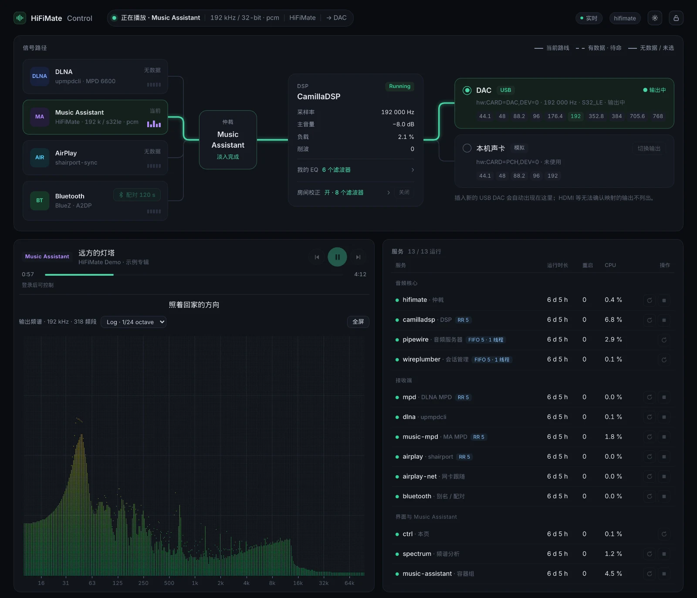
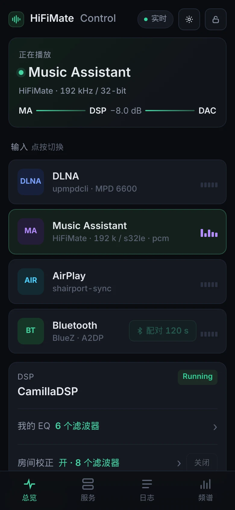
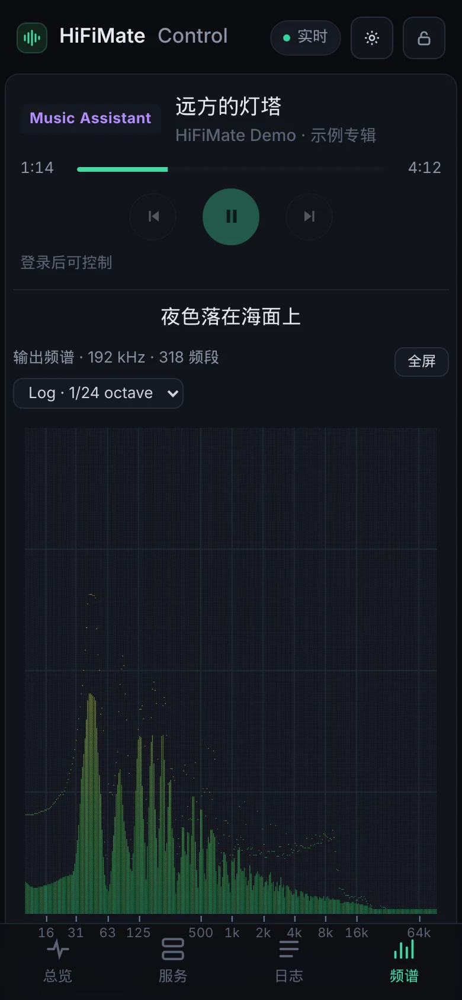
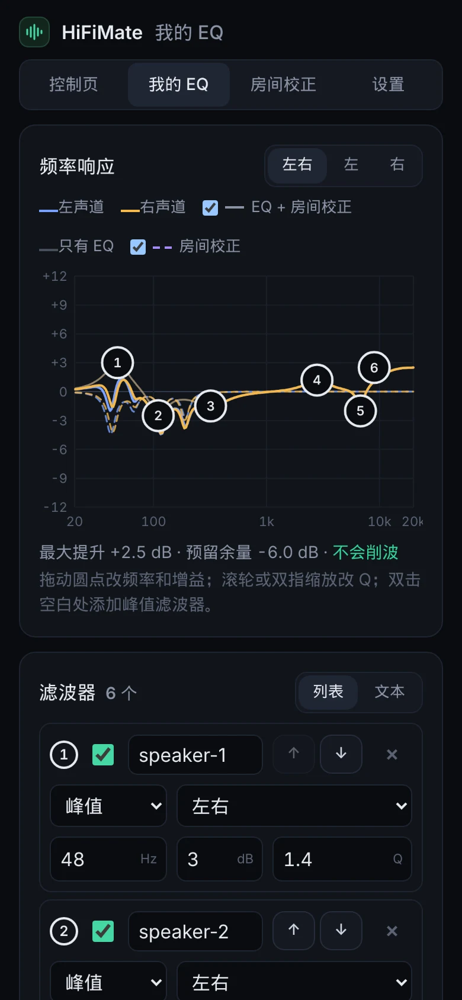
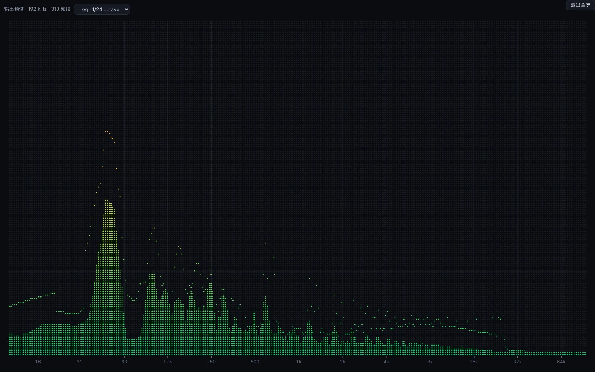
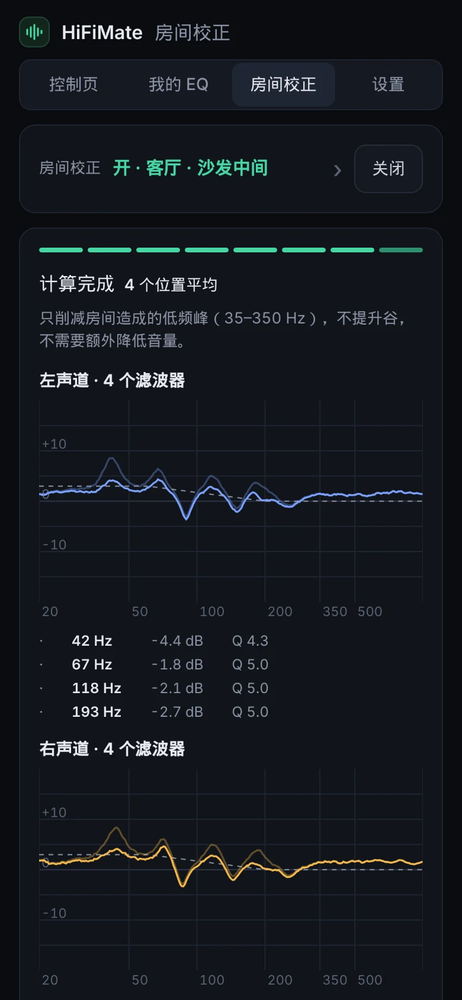
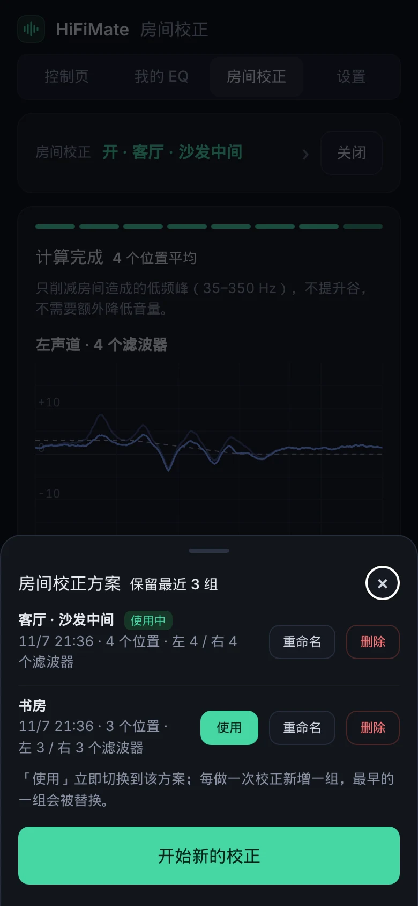
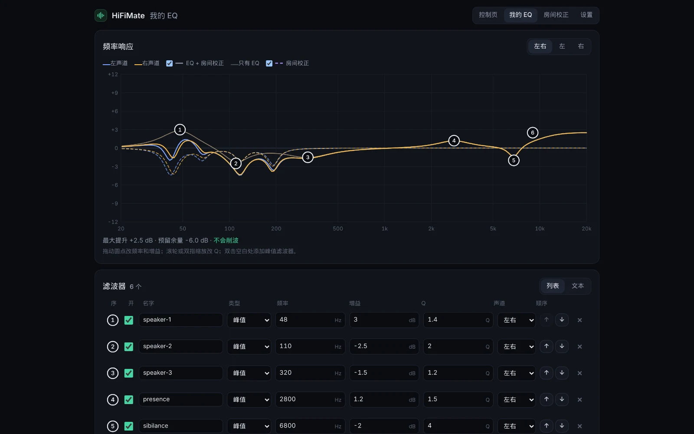

[中文](README.md) | **English**

# HiFiMate

Turn a small Linux box and a DAC into your home's hi-fi player: everyone's phones and computers can send music to it directly,
and it plays at the original sample rate.



<p>
  
  
  
</p>

<sub>The screenshots use demo data (the track, lyrics, EQ and room measurements are made up) and are generated by <code>tools/screenshots/</code>.
The web pages and command messages are in Chinese.</sub>

## When to use HiFiMate

You have speakers (or a headphone amp), a USB DAC and a spare computer: a mini PC, an old laptop, a NUC. HiFiMate helps when:

- **Everyone at home uses a different device.** The iPhone wants AirPlay, the Android phone Bluetooth or DLNA, the computer a music app.
  You don't want to replug cables or switch the DAC's input every time someone else plays.
- **You care about sound quality.** You have FLAC and hi-res files (96 kHz, 192 kHz or more) and want them to reach the DAC at their
  original sample rate, not all converted to 48 kHz by the system.
- **You want to control your local library from your phone.** Your music is on a disk, and you want to search, queue and play it
  from your phone like a streaming app.
- **Your speakers boom in your room, or you want an EQ for them**, without learning to configure DSP software.
- **You want to see what is playing**: the track, scrolling lyrics and a spectrum, in a browser on your phone or computer.

## What it does

Once installed, HiFiMate runs in the background, with no screen or keyboard:

- **Waits on four inputs at once**: AirPlay, DLNA, Bluetooth (the box is a Bluetooth speaker) and Music Assistant. Anyone presses play
  on their own device and it plays; whoever plays last takes over, and the previous device is paused automatically, so two streams never mix.
- **Follows the sample rate**: the DAC switches to each track's rate (44.1 kHz to 768 kHz), with no resampling.
  A format the DAC cannot play is reported as an error, never quietly played at a lower quality.
- **One web page for everything**: open the control page in a browser to see the track playing, word-by-word lyrics and a live spectrum;
  play/pause, skip and seek; switch inputs and DACs; pair a new phone over Bluetooth; check the services.
- **Manages your library and streaming services**: includes Music Assistant (a version that can load custom music providers,
  see [below](#music-assistant)) to browse your local library and queue music from the web or its phone app, and to connect providers
  such as QQ Music, NetEase Cloud Music, Bilibili, Migu, Spotify and Tidal.
- **Improves your room's sound**: measure a few times with an iPhone at your listening position, and it computes an EQ that cuts the
  room's bass resonances; apply it with one tap, turn it off any time. Microphone compensation curves for iPhone 15 and later are included.
- **Your own EQ**: a few lines of filters in CamillaDSP's syntax, the same for every sample rate, live as soon as you save.
- **Hassle-free**: fades in when playback starts, with no sudden pop; releases the DAC after 5 minutes of silence; installs with one command
  and upgrades with `hifimate upgrade`; uninstalling restores the services, configuration and system settings it changed.

## When it is not a fit

- Synchronized multi-room playback: HiFiMate drives one DAC.
- A Windows or macOS host: HiFiMate runs only on Linux (the phones and computers sending music can run anything).
- HDMI, optical or coaxial output: only USB DACs and the host's own analog output are supported for now.

## What you need

**The host**: a Linux computer with an x86_64 or aarch64 CPU, running Debian 13, Ubuntu 26.04, Fedora 43, Arch or openSUSE Tumbleweed
or newer (Ubuntu 24.04 needs a newer PipeWire first, see [INSTALL.en.md](INSTALL.en.md#11-operating-system)). It needs:

- **A USB port** for the DAC. Without a DAC, the host's own analog output (headphone jack) works too.
- **A network**: wired is best; on Wi‑Fi use 5 GHz if you can. Phones and computers must be on the same LAN as the host.
- **Bluetooth** (for the Bluetooth input): built in or a USB adapter.
- Docker for Music Assistant, and preferably 2 GB of memory or more.
- An account that can use sudo, to install.

Mini PCs, NUCs and old laptops are a good fit. A **Raspberry Pi** works too (a 4 or 5 is recommended, with the 64-bit Raspberry Pi OS
based on Debian 13), but note:

- The Pi's on-board Wi‑Fi and Bluetooth are one chip sharing one antenna. While Wi‑Fi carries data on 2.4 GHz (an AirPlay or
  Music Assistant stream, for example), Bluetooth audio tends to drop out. Use a cable, or Wi‑Fi on 5 GHz only; for the Bluetooth
  input, a USB Bluetooth adapter is better.
- Give the USB DAC enough power: use the official power supply, and a powered USB hub for a power-hungry DAC.
- With an SD card as the system disk, Music Assistant's library scans and database writes are slow and wear the card;
  booting from a USB SSD is better.

## Quick start

1. On the host, run (it asks for your sudo password):

   ```sh
   curl -fsSL https://github.com/hifimate/hifimate/releases/latest/download/install.sh | sudo sh
   ```

   The installer installs the system packages it needs, creates a user `hifimate` that runs HiFiMate, then asks for:
   - a device name, e.g. `Living Room`: phones then see `Living Room AirPlay`, `Living Room DLNA` and `Living Room Bluetooth`;
   - a password: it is the Linux password of the `hifimate` user, used for the control page and the music share; HiFiMate stores no password of its own;
   - a Music Assistant administrator account.

   It starts at boot from then on, with nobody logged in.
2. Play from a phone:
   - iPhone: Control Center → the AirPlay icon on the music card → `Living Room AirPlay`.
   - Android: in a DLNA-capable player (e.g. BubbleUPnP) choose `Living Room DLNA`, or connect to `Living Room Bluetooth` (pair first, see below).
3. Open `http://<host IP>/ctrl/` in a browser for the control page; `http://<host IP>/` is Music Assistant.
4. Put music in the library: open the shared folder `\\<host IP>\Music` on a computer (see [Adding music to the library](#adding-music-to-the-library)).

Without Music Assistant or the shared folder, replace the final `| sudo sh` with
`| sudo sh -s -- --without-music-assistant --without-share`. More install options, unattended installs and prerequisites are in [INSTALL.en.md](INSTALL.en.md).

## Using it

### AirPlay

On an iPhone or iPad, tap the AirPlay icon on the playback card in Control Center and choose `<name> AirPlay`; on a Mac, choose the
same device under Control Center → Sound in the menu bar. Pause on the sender, then play from another input to take over; when you
pause or switch away on the control page, HiFiMate pauses the sender too.

### DLNA

In a player with DLNA/UPnP output (BubbleUPnP, Foobar2000, the "cast" option of many music apps), choose `<name> DLNA`.

### Bluetooth

The host behaves like a Bluetooth speaker. Before the first connection, open the pairing window (120 seconds): tap the pairing button
(「配对 120 s」) on the control page's Bluetooth card, or run on the host:

```sh
sudo hifimate pair
```

Then choose `<name> Bluetooth` in your phone's Bluetooth settings. The window closes once paired; after that the phone just connects.
Bluetooth quality depends on the phone and the Bluetooth codec, and usually does not reach the sample rates of AirPlay or DLNA.

### Music Assistant

HiFiMate does not use the stock Music Assistant but the [Music Assistant Custom Loader](https://github.com/neqq3/ma_custom_loader)
maintained by [neqq3](https://github.com/neqq3): it is based on the official Music Assistant 2.10.9 image and only adds loading of custom
music providers at startup, without changing MA's own code. Thanks to the [Music Assistant](https://www.music-assistant.io/) team and to neqq3.

Music providers you can use:

- **Supported by Music Assistant itself** (add them in MA's settings): local files, SMB/NFS shares, WebDAV; media servers such as Plex,
  Jellyfin, Emby and Subsonic; **QQ Music**, **NetEase Cloud Music**, Spotify, Apple Music, Tidal, Qobuz, Deezer, YouTube Music,
  SoundCloud, Bandcamp; internet radio such as TuneIn and Radio Browser, podcasts and audiobooks.
  The full list is in [MA's documentation](https://www.music-assistant.io/music-providers/).
- **Bundled with HiFiMate**: Bilibili (the audio of Bilibili videos) and Migu Music.
- **Third-party providers you can subscribe to** (not installed by default; add the subscription yourself, see the
  [Music Assistant guide](music-assistant/README.en.md#third-party-music-providers)): for example
  [ma_ncloud_music](https://github.com/neqq3/ma_ncloud_music) (another NetEase Cloud Music provider) and
  [music-assistant-providers](https://github.com/andychao2024/music-assistant-providers) (LX Music, GD Studio, artist/album metadata from Douban and NetEase, and more).
  They are maintained by their own authors and are not part of HiFiMate.

What you can play depends on your own accounts' entitlements; see the [disclaimer](#disclaimer).

Open `http://<host IP>/` and sign in with the administrator created during installation. The installer has already set up HiFiMate as a
player in MA (`<name> MA`); add music providers and choose it to play. The steps are in the [Music Assistant guide](music-assistant/README.en.md).

### Adding music to the library

The music library on the host is `/srv/hifimate/music`; the installer shares it on the LAN as `Music`:

- **Windows**: type `\\<host IP>\Music` in File Explorer's address bar.
- **Mac**: Finder → Go → Connect to Server, then `smb://<host IP>/Music`. The host also appears under Network in Finder's sidebar.
- **Linux**: open `smb://<host IP>/Music` in the file manager.

The user name is `hifimate` and the password is the control page password. Copy your album folders in; Music Assistant scans the library
regularly, and to see new music at once, sync the provider by hand in MA's settings.
FLAC, ALAC, WAV, AIFF, MP3, AAC and other common formats are supported; organizing by artist/album/track is recommended.

### The control page

`http://<host IP>/ctrl/`. Everything can be viewed without signing in; playback control, switching inputs/outputs, Bluetooth pairing
and restarting services need the control page password.
On a computer it shows the signal path and the spectrum; on a phone it has four tabs: overview, services, logs and spectrum
(「总览」「服务」「日志」「频谱」).

Music Assistant's pages also get a draggable spectrum window in the bottom right corner, with the track playing and its lyrics; it can show
HiFiMate's output or analyse the sound the browser itself is playing.



### Room correction

You need an iPhone and about 4 minutes:

1. The first time, trust HiFiMate's local certificate (iPhones only allow microphone use on HTTPS pages): on the iPhone open
   `http://<host IP>/roomfit`, download and install "HiFiMate Local CA" as the page explains, then turn on full trust under
   Settings → General → About → Certificate Trust Settings.
2. Open the measurement page over HTTPS, sign in with the control page password and choose your phone model.
3. Take the phone out of its case, keep your usual listening volume, and place the phone at your listening position as prompted
   (ear height, bottom microphone facing the speakers). The measurement plays a sweep.
4. Measure the center, then a few positions about 30 cm to the front, back, left and right (at least 3); the page tells you whether each measurement is usable.
5. Check the predicted curves before and after correction and tap apply (「应用」). You can turn it on or off any time on the control page's DSP card.

The correction only treats room resonances between 35 and 350 Hz, and only cuts peaks, never fills dips.

<p>
  
  
</p>

A phone microphone is not flat in the bass, so the measurement subtracts the selected model's microphone curve. These curves come from
anechoic measurements published on the blog of [Faber Acoustical](https://www.faberacoustical.com/) (the makers of SignalScope);
the data belongs to Faber Acoustical:

| Measured model | Article | Same-generation models using this curve |
|---|---|---|
| iPhone 15 Pro Max | [2024-09](https://www.faberacoustical.com/blog/2024/ios/iphone/measured-iphone-15-pro-max-microphone-frequency-response-and-directivity/) | iPhone 15, 15 Plus, 15 Pro |
| iPhone 16 Pro | [2024-09](https://www.faberacoustical.com/blog/2024/ios/iphone/measured-iphone-16-pro-microphone-frequency-response-and-directivity/) | iPhone 16, 16 Plus, 16 Pro Max, 16e |
| iPhone 17 Pro | [2025-09](https://www.faberacoustical.com/blog/2025/ios/iphone/measured-iphone-17-pro-microphone-frequency-response-and-directivity/) | iPhone 17, Air, 17 Pro Max, 17e |
| iPhone 18 Pro | [2026-10](https://www.faberacoustical.com/blog/2026/ios/iphone/measured-iphone-18-pro-microphone-frequency-response-and-directivity/) | iPhone 18 Pro Max, iPhone Duo |

Models without their own measurement use the curve of the same generation's Pro; the page marks them as based on that measurement (「参考 … 实测」).

### Your own EQ

Tap My EQ (「我的 EQ」) on the control page's DSP card, or open `http://<host IP>/ctrl/eq/` directly, and sign in with the control page password:

- Drag the dots on the curve to change frequency and gain, scroll or pinch to change Q, double-click an empty spot to add a filter;
  or type values in the list below.
- The curves are computed by the CamillaDSP on the host, shown per channel, and can include the room correction and the two combined;
  it warns when a boost exceeds the reserved headroom and could clip.
- Paste a filter list exported from REW, AutoEQ or Equalizer APO to import it.
- Apply (「应用」) takes effect at once without interrupting playback; the A/B bypass (「旁路对比」) turns the EQ off temporarily for comparison;
  what was there before each apply is kept as a version (the last 10), which you can load any time.



Types the list cannot edit, such as FIR (Conv) and DiffEq, go in the page's text mode (「文本」). The EQ is saved in
`/opt/hifimate/config/dsp-filters.yml`, written like the `filters` and `pipeline` sections of a CamillaDSP configuration;
you can also edit it on the host, for example:

```yaml
filters:
  bass_peak: {type: Biquad, parameters: {type: Peaking, freq: 52, gain: -3.0, q: 1.7}}
  air_shelf: {type: Biquad, parameters: {type: Highshelf, freq: 8000, gain: 2.0, q: 0.7}}
pipeline:
  - {type: Filter, channels: [0, 1], names: [bass_peak, air_shelf]}
```

After editing it on the host, run `sudo hifimate reload-filters`: it checks the file first and applies it at once while playing.
The file is yours; reinstalling and upgrading never change it. The filter types and rules are in [INSTALL.en.md](INSTALL.en.md#43-your-own-eq).

### Settings

The gear in the top right corner of the control page (`http://<host IP>/ctrl/settings/`) changes the fade-in time, how long silence lasts
before the DAC is released, the allowed sample rates, and Music Assistant's third-party provider subscriptions. The device name,
password and web port are still changed with commands on the host; the page lists them.

## Managing it

All commands run with sudo:

| Command | What it does |
|---|---|
| `sudo hifimate status` | Show the version, output device, music library and the state of every service |
| `sudo hifimate upgrade` | Upgrade to the latest version with the options of the last install |
| `sudo hifimate install --name Study` | Reinstall with a changed option (here the name) |
| `sudo hifimate pair` | Open the Bluetooth pairing window |
| `sudo hifimate reload-filters` | Check and load an edited EQ |
| `sudo hifimate output` | List output devices; `--choose` to pick and switch |
| `sudo hifimate password` | Change the password (the Linux password of the `hifimate` user, shared by the control page and the music share) |
| `sudo hifimate logs airplay` | Show logs (also `dlna`, `bluetooth`, `camilladsp`, ...; all without one) |
| `sudo hifimate restart` | Restart all services |
| `sudo hifimate uninstall` | Uninstall; keeps the music library, Music Assistant's data and your settings |

## Installed files

HiFiMate runs as its own user `hifimate`; all its files belong to that user and none are in anyone's home directory. The ones you may need:

| What | Where | Notes |
|---|---|---|
| Music library | `/srv/hifimate/music` | Shared as `\\<host>\Music`; `/media` in Music Assistant |
| Your own EQ | `/opt/hifimate/config/dsp-filters.yml` | Edited on the EQ page; after editing by hand run `sudo hifimate reload-filters` |
| EQ versions | `/opt/hifimate/state/eq/versions/` | What was there before each apply on the EQ page, the last 10 |
| Playback settings | `/opt/hifimate/config/settings.json` | Written by the settings page: fade-in, idle release time, allowed sample rates |
| Other settings | `/opt/hifimate/config/hifimate.conf` | Defaults managed by the installer; do not edit, see [INSTALL.en.md](INSTALL.en.md#46-other-settings) |
| Room correction | `/opt/hifimate/config/room-correction.json` | Written by the room correction page; no need to edit |
| Music Assistant's port etc. | `/opt/hifimate/music-assistant/.env` | See the [Music Assistant guide](music-assistant/README.en.md#changing-the-web-port) |
| Third-party provider subscriptions | `/opt/hifimate/music-assistant/provider-subscriber/options.json` | Edited on the settings page, see the [Music Assistant guide](music-assistant/README.en.md#third-party-music-providers) |
| Music Assistant's data | `/var/lib/hifimate/music-assistant/` | Accounts, library index, settings; copy the whole directory to back it up |
| Local certificate | `/opt/hifimate/config/tls/ca.crt` | The root of the HTTPS certificate used by the room correction page |
| Install options | `/etc/hifimate/install.json` | The options `sudo hifimate upgrade` and `install` reuse; no passwords |
| The `hifimate` command | `/usr/local/bin/hifimate` | |
| Logs | System journal | View with `sudo hifimate logs` |

Most of it can be changed on the pages; to edit these files on the host, use `sudo nano <file>` (nano keeps the file's owner when saving).
The other files under `/opt/hifimate` are the program itself and are replaced on upgrade; do not edit them.
Reinstalling, upgrading and uninstalling keep the music library, EQ, room correction, certificates, `.env`, subscriptions and
Music Assistant's data from the table above.

## Documentation

- [INSTALL.en.md](INSTALL.en.md): prerequisites, install options, configuration, maintenance, uninstalling, troubleshooting, and notes for developers.
- [music-assistant/README.en.md](music-assistant/README.en.md): Music Assistant's setup, music providers and upgrades.
- [ARCHITECTURE.en.md](docs/ARCHITECTURE.en.md): how it works, and the technical details.

## Disclaimer

HiFiMate is an independent open-source project, not affiliated with NetEase Cloud Music, Bilibili, Migu,
Music Assistant or any hardware vendor. The bundled Bilibili and Migu providers only access content with your own
account through each service's public interfaces; nothing paid, premium or protected is provided or circumvented.
What you can play depends on your own account's entitlements. Third-party providers installed through Music Assistant
are not part of HiFiMate; their authors are responsible for them. You are responsible for complying with local law
and each service's terms; the content belongs to its rights holders.

## License

MIT, see [LICENSE](LICENSE); provided "as is", without warranty of any kind. Third-party software and data used are listed in [NOTICE.en.md](NOTICE.en.md).
